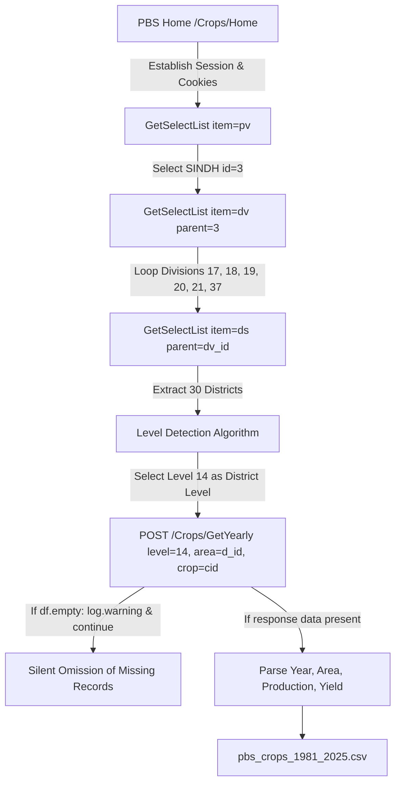

# Phase 3A: PBS Data Provenance and Pipeline Audit

**Document:** `reports/phase3a/source_provenance.md`  
**Investigation Date:** 2026-10-26  
**Investigated Scripts:** [`pbs_crops_api.ipynb`](file:///c:/Users/muet/Downloads/FYP_dataset/FYP_dataset_builder_code/pbs_crops_api.ipynb)  
**Live Endpoint Probed:** `https://na.data.gov.pk` (Pakistan Bureau of Statistics Data Portal)

---

## 1. Overview of the Crop Data Pipeline

The crop statistics in `pbs_weather_soil_1981_2025.csv` originate entirely from the notebook `pbs_crops_api.ipynb`. The notebook interacts with the JSON/XHR backend of the Pakistan Bureau of Statistics (PBS) Crop Portal (`https://na.data.gov.pk/Crops/Home`).



---

## 2. API Endpoints and Request Structure

### 2.1 Hierarchy Endpoints

1. **Province Selector:**  
   - **Request:** `GET https://na.data.gov.pk/Crops/GetSelectList/?item=pv&parent=0`  
   - **Response Payload:** Returns array of provinces: `[{'id': '1', 'name': 'KHYBER PAKHTUNKHWA'}, {'id': '2', 'name': 'PUNJAB'}, {'id': '3', 'name': 'SINDH'}, ...]`  
   - **Evidence:** `VERIFIED`. Direct inspection of live API returns Sindh `id = '3'`.

2. **Division Selector:**  
   - **Request:** `GET https://na.data.gov.pk/Crops/GetSelectList/?item=dv&parent=3`  
   - **Response Payload:** Returns 6 administrative divisions in Sindh:
     - `17`: `HYDERABAD DIVISION`
     - `18`: `KARACHI DIVISION`
     - `19`: `LARKANA DIVISION`
     - `20`: `MIRPUR KHAS DIVISION`
     - `21`: `SUKKUR DIVISION`
     - `37`: `SHAHEED BENAZIRABAD DIVISION`  
   - **Evidence:** `VERIFIED`.

3. **District Selector:**  
   - **Request:** `GET https://na.data.gov.pk/Crops/GetSelectList/?item=ds&parent=<division_id>`  
   - **Response Payload:** Returns district objects `{'id': '<code_string>', 'name': '<district_name>'}`.  
   - **Evidence:** `VERIFIED`. Across the 6 divisions, the endpoint returns **30 distinct district entities**. (Karachi Division contains 7 districts: Central, East, West, South, Malir, Korangi, Keamari; the interior contains 23 districts).

4. **Crop Selector:**  
   - **Request:** `GET https://na.data.gov.pk/Crops/GetCrops`  
   - **Response Payload:** Returns 125 crop definitions. The notebook filters for 5 major crops:
     - `1`: `Maize`
     - `2`: `Rice`
     - `3`: `Sugarcane`
     - `4`: `Wheat`
     - `5`: `Cotton`  
   - **Evidence:** `VERIFIED`.

### 2.2 Time Series Data Endpoint

- **Endpoint:** `POST https://na.data.gov.pk/Crops/GetYearly`
- **Request Parameters (Form Data):**
  - `level`: Integer geographic code (`11` = National, `12` = Provincial, `13` = Divisional candidate, `14` = District candidate).
  - `area`: Entity identifier string (e.g., `'3'` for Sindh province, `'069'` for Thatta, `'152'` for Sujawal).
  - `crop`: Integer crop ID (`1` to `5`).
- **Response Format:** JSON envelope containing an array under the `"data"` key:
  ```json
  {
    "data": [
      {
        "fiscalyear": "1981-82 ",
        "production": 1584.099979,
        "area": 727.600001,
        "yield": 2.177158
      }
    ]
  }
  ```

---

## 3. Data Processing and Pipeline Logic in `pbs_crops_api.ipynb`

### 3.1 Geographic Level Detection Logic (Cell 4)
The notebook authors did not have documented knowledge of PBS numeric level codes. To deduce them, they implemented a dynamic reconciliation test:
- They queried candidate levels `[13, 14, 15, 16]` for division child IDs and checked whether the sum matched Sindh wheat production at level `12`.
- Level `13` was detected as Division.
- Level `14` was detected as District (child districts summed to division total).
- **Finding (`VERIFIED`):** The detection heuristic was valid for major agricultural divisions like Larkana and Sukkur, but it assumed that all entity IDs returned by `item=ds` represented genuine, distinct district command territories.

### 3.2 Response Normalization and Parsing (Cell 2)
Function `parse_yearly(text)`:
- Normalizes JSON into columns `["Year", "Area", "Production", "Yield"]`.
- Strips non-numeric characters from numeric columns via `pd.to_numeric(re.sub(r"[^\d.\-]", "", str(x)), errors="coerce")`.
- Extracts `Year_start` via regex `\s*(\d{4})` (e.g., `"1981-82"` -> `1981`).
- Drops rows where `Year_start` is missing.

### 3.3 Critical Pipeline Vulnerability: Silent Skipping of Missing Responses (Cell 5)
In the main scraping loop:
```python
def scrape():
    frames = []
    for i, d in enumerate(districts, 1):
        for crop, cid in CROPS.items():
            try:
                df = yearly(DIST_LEVEL, d["id"], cid)
            except Exception as e:
                log.error("FAILED %s / %s: %s", d["name"], crop, e); continue
            if df.empty:
                log.warning("no data: %s / %s", d["name"], crop); continue
            df = df.assign(Division=d["division"], District=d["name"], District_ID=d["id"], Crop=crop)
            frames.append(df)
```
- **Direct Evidence (`VERIFIED`):** 
  1. If `yearly(DIST_LEVEL, d["id"], cid)` returns an empty frame (either HTTP timeout, server error, or an empty JSON response `{"data": []}`), the loop emits a `log.warning` and calls `continue`.
  2. No database or request ledger records which district–crop requests were made, which failed, and which returned empty tables.
  3. Consequently, in the final CSV, **a missing combination cannot be distinguished from a zero-cultivation event, a server outage, or an empty response**.

---

## 4. Local Provenance Artifacts

- **Saved Raw Responses:** None. The notebook streamed responses directly into memory, saved interim checkpoints (`pbs_crops_1981_2025.csv.partial`), and wrote the final combined CSV. No raw JSON payloads were cached to disk.
- **Source Metadata:** No metadata file was created documenting scraping timestamps, HTTP headers, API version, or provincial reconciliation totals.

---

## 5. Direct Evidence vs. Assumptions

| Pipeline Aspect | Direct Evidence (`VERIFIED`) | Modeling Assumption (`UNRESOLVED` / Caution) |
|---|---|---|
| **Base URL & Routes** | `https://na.data.gov.pk/Crops/...` confirmed active and returning data. | Assumed server endpoint remains permanent without schema migrations. |
| **District Level Code** | Level `14` returns district-level records for almost all districts. | Assumed *all* IDs under `item=ds` are pure district command areas (disproven by ID 152). |
| **Missing Combinations** | 2,038 combinations are absent because `df.empty` was skipped. | Cannot assume missing records imply zero historical cultivation. |
| **Crop IDs** | Crop IDs 1 to 5 verified directly against live `/Crops/GetCrops`. | Assumed generic UI labels apply equally to specialized crops like cotton. |
