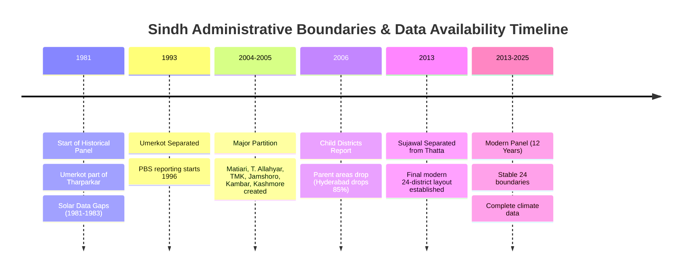

# Phase 3B: Geographic Coverage and Temporal Partitioning Assessment

**Document:** `reports/phase3b/geographic_coverage_assessment.md`  
**Investigation Date:** 2026-10-26  
**Objective:** Evaluate candidate temporal spans and boundary harmonization strategies for conference paper publication and FYP extension.

---

## 1. Comparative Analysis of Candidate Coverage Periods

| Evaluation Criterion | Candidate Period 1: Modern Era (2013–14 to 2024–25) | Candidate Period 2: Intermediate Panel (2006–07 to 2024–25) | Candidate Period 3: Full Panel (1981–82 to 2024–25) |
|---|---|---|---|
| **Temporal Duration** | **12 Crop Cycles** | **19 Crop Cycles** | **44 Crop Cycles** |
| **Active Districts** | **All 24 Modern Districts** | 23 Districts (2006–2012), 24 Districts (2013+) | Dynamic (16 -> 17 -> 23 -> 24 districts) |
| **Boundary Stability** | **100% STABLE.** Zero administrative partitions occurred after October 2013. | **95.8% STABLE.** Only Thatta/Sujawal partition in 2013; other 22 districts stable. | **SEVERE INSTABILITY.** 8 child districts formed across 3 separate partition waves (1993, 2004–05, 2013). |
| **Climate & Solar Quality** | **PRISTINE.** MERRA-2 and satellite solar radiation (`solar_mean`) 100% complete (0 NaNs). | **PRISTINE.** 100% complete climate features. | **IMPAIRED.** 141 missing values in `solar_mean` (1981–1983 satellite sensor gap). |
| **Target Data Validity** | **VERY HIGH.** Wheat, Cotton, Sugarcane, Maize 100% clean across all 24 districts. Rice 100% clean across 22 districts. | **HIGH.** Same as Period 1, with Sujawal rice quarantined and Thatta rice missing. | **COMPLEX.** Sudden step-downs in parent district areas (e.g. Hyderabad drops from 86k to 12k ha). |
| **Agronomic Relevance** | **MAXIMUM.** Reflects contemporary climate change, recent megafloods (2022), modern irrigation canal operations, and current seed varieties. | **HIGH.** Covers post-2010 flood era and modern irrigation regimes. | **MIXED.** Early 1980s farming practices, canal allocations, and crop varieties differ substantially from today. |
| **Scientific Defensibility for Conference Paper** | **STRONGEST DEFENSE.** Eliminates spatial artifacts, avoids artificial time-series jumps, and provides clean, explainable recommendations. | **ACCEPTABLE** if 2013 Thatta/Sujawal split is documented. | **DEFENSIBLE ONLY WITH AGGREGATION** into ~16 historical composite parent districts. |

---

## 2. The Spatial Domain Shift Hazard in Longitudinal Modeling

A major risk in training machine learning models on the raw 1981–2025 panel is the **Administrative Step-Down Phenomenon**:
- In 2005–06, Hyderabad recorded **86,100 hectares** of wheat.
- In 2006–07, Hyderabad recorded **11,700 hectares** of wheat.
- A machine learning model (e.g., Random Forest, XGBoost, or Neural Network) with district one-hot encoding or static coordinates would misinterpret this 85% drop as an agronomic collapse or extreme climate failure, when in reality it was purely a pencil-stroke administrative boundary reorganization (Matiari, Tando Allahyar, and TMK taking their respective command areas).
- Similar artificial drops occurred in Larkana (giving land to Kambar Shahdadkot), Dadu (giving land to Jamshoro), and Jacobabad (giving land to Kashmore).

---

## 3. Recommended Phased Geographic Strategy

### A. Recommended Strategy for Conference Paper: Candidate Period 1 (2013–14 to 2024–25)
1. **Core Panel Definition:** Restrict the conference paper dataset to the **12-year modern period (2013–14 to 2024–25)**.
2. **Advantages:**
   - Perfect 1-to-1 mapping with modern district boundaries recognized by farmers and extension officers.
   - 100% complete daily climate and solar radiation features (zero imputation required).
   - Clean handling of Thatta and Sujawal: Thatta Rice is absent and Sujawal Rice is quarantined, while all other 4 crops in Thatta and Sujawal remain fully valid. Rice models train on 22 complete districts without geographic distortion.
   - Eliminates all administrative step-down artifacts.
3. **Validation Strategy:** Chronological train/validation splits (e.g., Train: 2013–14 to 2020–21; Test: 2021–22 to 2024–25), preserving the temporal arrow of time and testing model performance against recent flood (2022) and post-flood recovery regimes.

### B. Extended Strategy for Final Year Project (FYP): Multi-Horizon Modeling
1. **Model Track 1 (Micro-District Modern Recommender):** 2013–2025 panel across 24 modern districts for localized farmer advisory.
2. **Model Track 2 (Macro-District 44-Year Historical Climate Engine):** Spatially re-aggregate child districts back into their 16 historical parent clusters (e.g., "Greater Hyderabad" = Hyderabad + Matiari + Tando Allahyar + TMK) from 1981 to 2025. This enables analyzing 44-year long-term climate adaptation and yield trends without administrative discontinuity.
